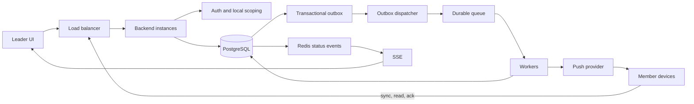
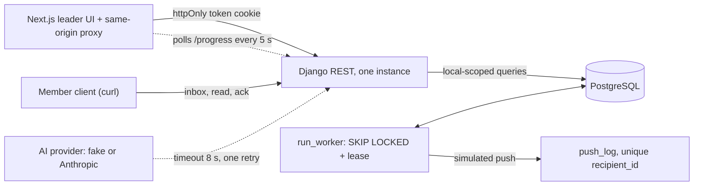

# CrewLink – Design

## Requirements
- Union leaders send updates, emergency notices and callouts to members of **their own local** only. Members must actually receive them, even after hours or days offline.
- Per message the leader sees who it went to, who received it, who has seen it, who replied. Members can reply "I'm coming" / "Can't attend"; the leader sees a live count.
- Every local's data stays private to that local.
- Concerns: push fails silently 5–10% of the time, so "sent" is not "received"; apprentice contact info may leak across locals; no member may act with leader permissions; retries, restarts and resends must never deliver twice to the same member.

## Assumptions
- Audience is the whole local (the build also supports optional classification filters). Apprentices count as members.
- Per member four states: sent, delivered, seen, responded. No reply means no information, not "not coming".
- Fallback channel (e.g. SMS after a sender-set time) is designed and documented, not built. Push is the only channel.
- "As soon as possible" is undefined; assumed X seconds for online members and on reconnect for offline ones. Only business managers (leaders) may send until Denise says otherwise.
- Done means the leader sees each member's status, not that a send was attempted.

## Design prompts
*(Sections 1–4 below are the design; each ends with **Built** = what this repo actually does.)*

### 1. Data model
- PostgreSQL: relationships matter and counts must be reconcilable per person.
- Tables: `locals`; `users`; `memberships` (user, local, role, status); `messages` (local, sender, content); `message_recipients` (message, member, delivery_status, read_at, acknowledged_at, attendance_response, responded_at); `delivery_attempts` (recipient, attempt, idempotency_key, status); `outbox_events`; `audit_logs`.
- One recipient row per member at send time, so we know **who** did not get it, not just a total.
- States are separate columns/events, not one status that overwrites the last. A member can read, then say "coming".
- Unique `(message_id, member_id)`.
- **Built:** `locals`, `members`, `accounts` (one per member, role member|leader), `announcements` (draft→approved→sent), `announcement_recipients` (sent_at, read_at, acked_at, plus claim and lease columns), `push_log`. Composite foreign keys (migration 0002) make the database refuse a recipient, announcement or account whose `local_id` differs from its member's or announcement's. CHECK constraints tie `approved_at` to status and `sent_at` to `status='sent'`. `push_preview` is `varchar(120)`.

### 2. Send path (Denise presses Send at 14:02)
1. Load balancer → backend instance; authenticate; check Denise leads Local 27.
2. One transaction: save message, create recipient rows for all active members (22,400), write an outbox event. Any failure rolls back everything.
3. Return 202 with the message id within about 2 s. Nothing waits for 22,400 phones.
4. Dispatcher publishes outbox events to a durable queue. Workers send in batches; the idempotency key is message+member. Provider acceptance is recorded separately from device delivery. Offline devices sync their durable inbox on reconnect. A crashed worker's batch is picked up by another.
5. Live status: status changes publish through Redis; leaders watch via SSE with batched updates (about every 2 s) so four open screens do not mean four queries per second.
- **Built:** the recipient table is the queue (no broker, no outbox). The send transaction inserts recipients with one `INSERT … SELECT … ON CONFLICT DO NOTHING`. `run_worker` claims batches with `FOR UPDATE SKIP LOCKED`, sets a lease and `attempts+1`, writes `push_log`, and marks `sent_at`, all in one transaction. Leader screen polls `/progress/` every 5 s. The inbox exists from the moment the send commits, so offline members lose nothing.

### 3. The two rules
**Rule 1 – isolation and permissions**
- Every local-owned row carries `local_id`; composite FKs stop cross-local links.
- Postgres Row Level Security as a second layer; role checks on every action (a member cannot call leader endpoints).
- Default deny: an endpoint without an explicit policy is refused.
- Automated cross-local and member-as-leader tests.
- **Built:** all tenant queries go through `for_account()`, and the local comes from the authenticated account, never the request. Another local's announcement returns 404, identical to a missing one. Leader endpoints use `IsLeader`, which reads the role from the database per request. Default is `DenyAll`, and a startup check (`core/checks.py`) fails `manage.py check`, runserver and tests for any route lacking a declared policy. Member URLs carry only an announcement id, so there is no recipient or member id to tamper with. **Not built:** RLS.

**Rule 2 – no duplicate delivery**
- Constraints and idempotency, not frontend discipline: unique recipient rows, same idempotency key on retry, outbox so message and job commit together, workers check existing delivery before acting, a leader retry reuses the original message.
- Dependency: the push provider must support idempotency keys. Otherwise a crash after the provider accepts but before we record it makes strict exactly-once impossible. Verify before claiming it.
- **Built:** the send winner is decided by one conditional `UPDATE … WHERE status='approved' AND sent_at IS NULL`; losers and retries create nothing and get 200 `already_sent`. `push_log.recipient_id` is unique, so a second push for the same recipient cannot be recorded. A worker only pushes rows still leased to itself, so an expired worker cannot overwrite the new owner. Tested with real threads (concurrent sends, concurrent workers, worker run twice, lease expiry). Provider limitation documented in `worker.py`: after an ambiguous crash we resend and collapse on the device by announcement id.

**Production monitoring (designed, not built):** alert on denied cross-local attempts, unexpected 403s, duplicate idempotency-key hits, failed deliveries, stuck queue jobs, and the gap between provider acceptance and app confirmation; audit-log who changed what.

### 4. Architecture diagram
Production design (original, rendered image: [docs/architecture-production-design.png](docs/architecture-production-design.png)):

What this repo builds:

## What I Cut
**Cut for time (and what I'd do next):**
- **Nginx / load balancer and multiple backend instances:** one Django dev server. The correctness mechanisms (conditional UPDATE, `SKIP LOCKED`, leases) are exercised with threads, not with several processes behind a balancer. Next: gunicorn behind Nginx, 2+ instances, and rerun the concurrency tests across processes.
- **Real push provider:** a `push_log` row stands in. Next: FCM/APNs adapter with collapse IDs, and verify provider-side idempotency.
- **Outbox, queue, Redis, SSE:** replaced by the recipient table as queue and 5 s polling. Fine at this scale; next: outbox + broker if volume or latency demands it.
- **Advanced monitoring and audit logs:** only log lines. Next: metrics and alerts listed in section 3, audit table.
- **Production deployment:** `runserver`, DEBUG, `.env` secrets, no HTTPS, non-expiring tokens. Next: containers built for prod, secrets manager, TLS, token expiry/rotation, CI.

**Gaps against the original brief (not done, stated plainly):**
- Attendance replies ("coming" / "can't attend") and the live attendance count.
- A separate "delivered" (device-confirmed) state; we track provider-accepted, read and acknowledged.
- A per-member status list for leaders; the dashboard shows counts only.
- The SMS fallback (designed above, not built).
- Postgres Row Level Security; isolation relies on composite FKs and scoped queries.
- Send permission is any leader of the local, not business-manager only; no `approved_by` column; no heartbeat on worker leases; page-number pagination instead of cursors.
- The real Anthropic provider is tested with mocked network only.
